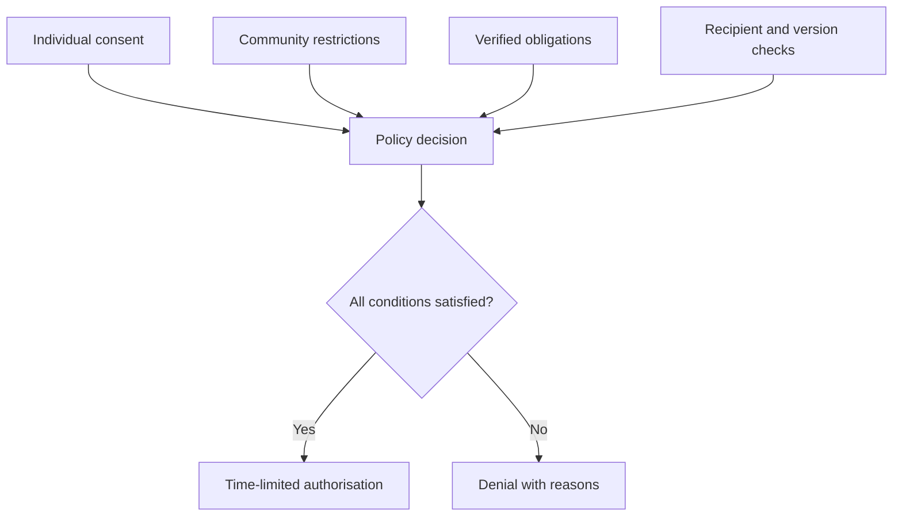

# Community Data Covenants

**Consent-aware research data governance under intermittent connectivity**

Community Data Covenants is a research prototype exploring how institutions can honour changing individual permissions, community-defined restrictions and data-use obligations when connectivity is unreliable. Its intended application is sensitive community-based research, including mental health AI.

## Why this matters

A consent withdrawal recorded on an offline device may not reach a research institution immediately. Persistent access permissions can therefore outlive the contributor's authorisation. Shorter access windows reduce this risk, but may also interrupt legitimate research involving poorly connected communities.

This project examines that tension through a policy decision model and a reproducible comparative experiment. It treats individual refusal as a binding constraint, not a cost to be traded against research convenience.

## Explore the project

| Component | Purpose |
| --- | --- |
| [Policy model](covenant.py) | Evaluates consent, purpose, recipient approval, policy versions and outstanding obligations. |
| [Comparative experiment](experiment.py) | Compares five expiry policies using identical synthetic request sequences. |
| [Automated tests](test_covenant.py) | Checks decision boundaries, withdrawal, conflicts, obligations and experimental reproducibility. |
| [Methodology](METHODOLOGY.md) | Defines scenarios, denominators and interpretation. |
| [Scope and safeguards](LIMITATIONS.md) | Describes technical boundaries, ethical safeguards and development provenance. |

## Architecture



The diagram represents the implemented decision logic, not a deployed network architecture.

## Run locally

Python 3.10 or later is required. No third-party dependencies or credentials are needed.

```bash
git clone https://github.com/ibkdee/community-data-covenants.git
cd community-data-covenants
python -m unittest -v
python experiment.py
```

The experiment writes subgroup counts to `results.csv` and prints aggregate error rates. It generates 9,000 synthetic episodes with 30 requests per episode, replayed across five policies. The 270,000 requests per policy are simulated events, not people or clinical observations.

## Governance model

A request is eligible only when the recipient is approved, consent is active, the purpose is individually and collectively permitted, the consent snapshot is sufficiently fresh, versions agree and no applicable unverified obligation is overdue. An eligible decision expires at the earliest applicable lease, freshness or obligation deadline.

The comparative experiment is a separate analytical model; it does not exercise the policy model's exact lease settings.

## Development status

Research prototype. The repository contains executable reference logic and a synthetic experimental design, not a deployed access-control service. Authentication, offline synchronisation, community validation and independent security assessment are outside the current implementation.

The project uses no patient information or proprietary client data. ChatGPT assisted with concept development, implementation, tests and documentation.

## Research foundations

The approach draws on existing work in machine-readable data-use conditions, including [W3C ODRL](https://www.w3.org/TR/odrl-model/) and the [GA4GH Data Use Ontology](https://www.ga4gh.org/product/data-use-ontology-duo/). It investigates their practical application and associated distributional trade-offs rather than claiming to invent consent management or policy enforcement.

Project materials are publicly inspectable; no software licence has yet been granted.
