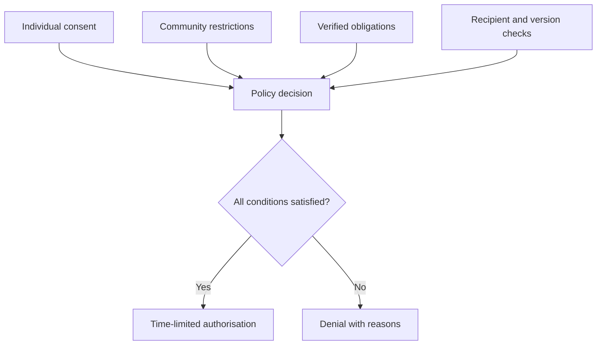

# Community Data Covenants

**Consent-aware research data governance under intermittent connectivity**

Community Data Covenants is a research prototype exploring how institutions can honour changing individual permissions, community-defined restrictions and data-use obligations when connectivity is unreliable. Its intended application is sensitive community-based research, including mental health AI.

[Interactive research laboratory](https://ibkdee.github.io/community-data-covenants/) · [Experimental findings](RESULTS.md) · [Reproduce the study](METHODOLOGY.md) · [Consent Assurance Receipt](ASSURANCE.md)

## Why this matters

A consent withdrawal recorded on an offline device may not reach a research institution immediately. Persistent access permissions can therefore outlive the contributor's authorisation. Shorter access windows reduce this risk, but may also interrupt legitimate research involving poorly connected communities.

This project examines that tension through a policy decision model and a reproducible comparative experiment. It treats individual refusal as a binding constraint, not a cost to be traded against research convenience.

## Explore the project

| Component | Purpose |
| --- | --- |
| [Policy model](covenant.py) | Evaluates consent, purpose, recipient approval, policy versions and outstanding obligations. |
| [Comparative experiment](experiment.py) | Compares five expiry policies using identical synthetic request sequences. |
| [Automated tests](test_covenant.py) | Checks decision boundaries, withdrawal, conflicts, obligations and experimental reproducibility. |
| [Methodology](METHODOLOGY.md) | Defines scenarios, denominators and interpretation. |
| [Scope and safeguards](LIMITATIONS.md) | Describes technical boundaries and ethical safeguards. |

## Experimental findings

| Access policy | Post-withdrawal requests permitted | Legitimate requests denied |
| --- | ---: | ---: |
| Persistent | 100.00% | 0.00% |
| Fixed 30 minutes | 8.78% | 78.20% |
| Fixed 120 minutes | 37.02% | 51.32% |
| Fixed 480 minutes | 69.18% | 20.85% |
| Sensitivity-dependent | 39.30% | 49.16% |

The experiment uses 36,237 post-withdrawal and 233,763 legitimate synthetic requests per policy. No policy dominates all alternatives on both outcomes. The sensitivity-dependent policy trades a higher post-withdrawal permission rate for a lower legitimate denial rate relative to fixed two-hour expiry. See [counts and interpretation](RESULTS.md).

## Revocation transport study

A second executable study examines whether prioritising small authenticated revocation messages over queued research uploads can reduce stale-consent exposure. The comparison uses the same contact schedule, byte budget and withdrawal event across four policies, with and without a fixed expiry. The local gateway binds decisions to a synthetic contributor and dataset, rejects modified or replayed messages, and prevents reads after a received withdrawal or expiry.

- [Revocation transport model](revocation.py)
- [Paired transport experiment](transport_experiment.py)
- [Failure-state tests](test_revocation.py)
- [Transport study design and boundaries](TRANSPORT.md)

Run `python transport_experiment.py` to obtain the comparative latency and access counts. The transport study is distinct from the original expiry experiment above; it evaluates an executable local gateway, not a deployed communications network.

## Custodian acknowledgement prototype

The [persistent custodian model](custodian.py) stores scoped withdrawal state in SQLite and returns an authenticated acknowledgement only after the transaction commits. Repeated delivery of the same event returns the original acknowledgement; missing or mismatched receipts remain unconfirmed. The [custodian tests](test_custodian.py) cover restart recovery, replay, modified events and partial confirmation.

This component is a local model of independently operated custodians. It does not implement a real multi-institution network, prove deletion of exported copies, or protect against restoration of an older database backup. The components can run independently or together in the synthetic workflow; they do not constitute a production service.

## Consent Assurance Receipt

The [assurance model](assurance.py) aggregates authenticated delivery and enforcement acknowledgements for a specified set of custodians. It distinguishes awaiting confirmation, receipt acknowledged and enforcement acknowledged. It reports complete acknowledgement only for a non-empty set of known custodians with matching enforcement receipts.

The [assurance tests](test_assurance.py) cover invalid authentication, future timestamps, duplicate acknowledgements, incomplete scope and prevention of status downgrade. Delivery acknowledgements are generated by a trusted synthetic receiver model, not a deployed transport service. See [receipt semantics and boundaries](ASSURANCE.md).

## Run a complete synthetic governance scenario

Run `python workflow_demo.py` to see the policy, transport, custodian and assurance components operate together. The scenario permits academic access, denies commercial use prohibited by the community and access when an obligation is overdue, schedules a withdrawal, distinguishes delivery from enforcement and records partial then complete acknowledgement across two participating institutions.

The [workflow](workflow_demo.py) and [integration test](test_workflow_demo.py) demonstrate how the components work together in a controlled environment. The clock, keys, policy inputs and institutions are synthetic. Acknowledgements describe historical enforcement at a particular time, not a guarantee of current state; database rollback and undiscovered custodians remain unresolved.

## Architecture



The diagram represents the implemented decision logic, not a deployed network architecture.

## Run locally

Python 3.10 or later is required. The published numerical results are reproduced with Python 3.13.5, the version used by the automated verification workflow. No third-party dependencies or credentials are needed.

```bash
git clone https://github.com/ibkdee/community-data-covenants.git
cd community-data-covenants
python -m unittest -v
python demo.py
python workflow_demo.py
python experiment.py
python transport_experiment.py
```

The experiment writes subgroup counts to [`results.csv`](results.csv) and prints aggregate error rates. The [verification workflow](.github/workflows/verify.yml) checks both experiments against the committed CSV files. It generates 9,000 synthetic episodes with 30 requests per episode, replayed across five policies. The 270,000 requests per policy are simulated events, not people or clinical observations.

## Governance model

A request is eligible only when the recipient is approved, consent is active, the purpose is individually and collectively permitted, the consent snapshot is sufficiently fresh, versions agree and no applicable unverified obligation is overdue. An eligible decision expires at the earliest applicable lease, freshness or obligation deadline.

The comparative experiment is a separate analytical model; it does not exercise the policy model's exact lease settings.

## Development status

Research prototype. The repository contains executable reference logic and a synthetic experimental design, not a deployed access-control service. Message authentication and local persistent withdrawal state are implemented in separate components. User identity verification, real network synchronisation, community validation and independent security assessment remain outside their scope.

The project uses no patient information or proprietary client data.

## Research foundations

The approach draws on existing work in machine-readable data-use conditions, including [W3C ODRL](https://www.w3.org/TR/odrl-model/) and the [GA4GH Data Use Ontology](https://www.ga4gh.org/product/data-use-ontology-duo/). It investigates their practical application and associated distributional trade-offs rather than claiming to invent consent management or policy enforcement.

The project software and associated documentation are available under the [MIT License](LICENSE). This licence does not grant permission to use third-party or personal data.
